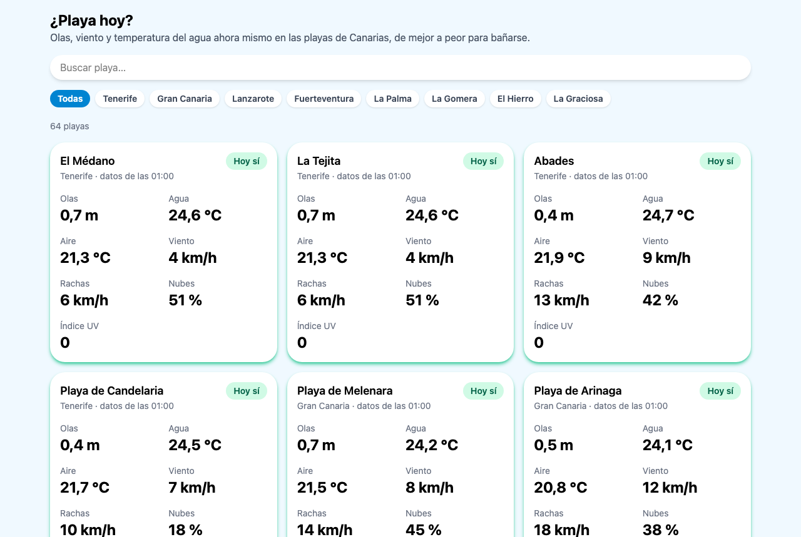

# ¿Playa hoy?

[](https://github.com/CarlosMarreroM/playa-hoy/actions/workflows/deploy.yml)

App web que te dice si merece la pena ir hoy a la playa en Canarias. Muestra las olas, el viento y la temperatura del agua en tiempo real de 64 playas de las 8 islas, y les pone una nota: **hoy sí**, **regular** o **hoy no**.

**Demo:** <https://carlosmarrerom.github.io/playa-hoy/>



> En desarrollo. Sigue el progreso en el [tablero del proyecto](https://github.com/users/CarlosMarreroM/projects/4).

## Qué hace

- **64 playas de las 8 islas** con datos reales de la hora actual: olas, temperatura del agua y del aire, viento, rachas, nubes e índice UV.
- **Nota del día** para cada playa, calculada por la app a partir de las olas, el viento y el agua.
- **Ordenadas de mejor a peor**: lo primero que ves son las mejores playas para bañarse ahora.
- **Buscador** por nombre que no distingue tildes ni mayúsculas ("medano" encuentra "El Médano").
- **Filtro por isla**.
- **Diseño adaptable**: 1 columna en el móvil, 2 en tablet y 3 en pantallas grandes.
- **Estados de carga y de error** en todo momento, con tarjetas provisionales mientras llegan los datos.

### Cómo se calcula la nota

Cada dato se puntúa por separado y la nota final es **la del peor**: si un dato es malo, la playa es mala aunque el resto sea perfecto.

| Dato   | Hoy sí           | Regular          | Hoy no         |
| ------ | ---------------- | ---------------- | -------------- |
| Olas   | menos de 0,8 m   | menos de 1,5 m   | 1,5 m o más    |
| Viento | menos de 20 km/h | menos de 30 km/h | 30 km/h o más  |
| Agua   | 21 °C o más      | 19 °C o más      | menos de 19 °C |

Los límites están todos juntos en `src/utils/rating.ts`, para poder ajustarlos sin tocar la lógica.

## Stack

- **React 19 + TypeScript** con **Vite**
- **Tailwind CSS 4** para los estilos
- **axios** para las peticiones a la API
- **ESLint + Prettier** (con `prettier-plugin-tailwindcss` para ordenar las clases)
- **GitHub Actions + GitHub Pages** para el despliegue automático en cada push a `main`

## Hoja de ruta

- [x] Fase 0: preproyecto
- [x] Fase 1: una playa con datos reales
- [x] Fase 2: todas las playas y nota del día
- [ ] Fase 3: detalle, rutas y favoritos
- [ ] Fase 4: gráficas y caché
- [ ] Fase 5: mapa
- [ ] Fase 6: tests y pulido

Cada fase tiene su issue con las tareas y se sigue en el tablero de GitHub Projects.

## Estructura

```text
src/
├── api/
│   └── openMeteo.ts            # Llamadas a Open-Meteo (varias playas por petición)
├── components/
│   ├── BeachList.tsx           # Lista: carga los datos, filtra, ordena y pinta el grid
│   ├── BeachCard.tsx           # Tarjeta de una playa (solo muestra datos)
│   ├── BeachCardSkeleton.tsx   # Tarjeta provisional mientras cargan los datos
│   ├── SearchBar.tsx           # Buscador por nombre
│   ├── IslandFilter.tsx        # Botones de filtro por isla
│   └── GlassPanel.tsx          # Contenedor común de las tarjetas
├── data/
│   ├── beaches.ts              # Las 64 playas (nombre, isla, latitud, longitud)
│   └── islands.ts              # Lista de islas y su tipo
├── hooks/
│   └── useBeachesForecast.ts   # Pide la previsión de todas las playas
├── styles/
│   └── ratingStyles.ts         # Texto y colores de cada nota
├── types/
│   ├── beach.ts                # Tipos de la app (Beach, BeachConditions…)
│   └── openMeteo.ts            # Tipos de las respuestas de la API
├── utils/
│   ├── errors.ts               # Mensajes de error para el usuario
│   ├── format.ts               # Formato de los valores en pantalla
│   ├── rating.ts               # Nota del día y orden por nota
│   ├── search.ts               # Búsqueda sin tildes ni mayúsculas
│   └── transform.ts            # Respuestas de la API → BeachConditions
├── App.tsx
└── main.tsx
```

La lista de playas es un archivo de datos propio; la API solo aporta la previsión. El despliegue está en `.github/workflows/deploy.yml`.

## Arrancar en local

```bash
npm install
npm run dev       # servidor de desarrollo
npm run build     # build de producción en dist/
npm run preview   # sirve el build en local para comprobarlo
npm run lint      # revisa el código con ESLint
```

## Decisiones técnicas

### Datos y API

- **axios en lugar de `fetch`.** Antes de usar axios, hice una llamada de prueba con `fetch`: solo lanza error si falla la red, y los errores HTTP (400, 500…) hay que comprobarlos a mano con `response.ok`. axios lanza el error en los dos casos, convierte el JSON automáticamente y permite configurar un tiempo máximo de espera.
- **Una instancia de axios por API.** Open-Meteo sirve la previsión marina y la del tiempo desde servidores distintos. Cada instancia tiene su URL base, un `timeout` y la zona horaria de Canarias por defecto, para que nunca falte en una petición.
- **Una petición para todas las playas.** Open-Meteo acepta varias coordenadas separadas por comas y devuelve una respuesta por punto, en el mismo orden. Así la app hace **2 peticiones en total** (mar y tiempo) en lugar de 2 por playa, que con 64 playas serían 128. Con un solo punto la API devuelve un objeto en lugar de un array, y el cliente lo normaliza.
- **`Promise.all` para las dos APIs.** Las peticiones del mar y del tiempo salen a la vez en lugar de una detrás de otra, así que la espera es la de la más lenta y no la suma de las dos.
- **Dos niveles de tipos.** Los tipos de `types/openMeteo.ts` reflejan el JSON tal como llega (arrays paralelos por horas). Una función de transformación los convierte en `BeachConditions`, el tipo que usa la interfaz. Si cambiara la API, solo habría que tocar la transformación.
- **Variables separadas por comas.** Open-Meteo documenta las listas de variables separadas por comas, así que se envían con `join(',')` en lugar de dejar que axios use su formato con corchetes (`hourly[]=`).
- **Coordenadas comprobadas.** Las ubicaciones de las playas salen de OpenStreetMap, y todas están comprobadas contra Open-Meteo para asegurar que tienen datos de olas, agua y tiempo.

### Estado y lógica

- **Estado como unión discriminada.** El estado de la petición es `loading`, `error` o `success`, y cada uno lleva solo sus datos. Así es imposible tener a la vez datos y error, y TypeScript obliga a tratar cada caso.
- **Cancelación con `AbortController`.** Si la lista desaparece antes de que lleguen los datos, la petición se cancela en la limpieza del `useEffect`.
- **Lógica fuera de React.** La nota del día, el orden y la búsqueda son funciones puras en `utils/`, sin React, para poder testearlas por separado.
- **Filtrar no pide nada a la API.** Los datos de todas las playas llegan una vez. El buscador y el filtro solo guardan lo que ha elegido el usuario, y la lista visible se calcula en cada renderizado a partir de los datos y los filtros. No se guarda en otro estado, así que nunca puede quedar desincronizada.
- **Búsqueda sin tildes.** El texto se normaliza con `normalize('NFD')` y se quitan las tildes antes de comparar.
- **Islas como tipo.** El tipo `Island` se saca de la lista `ISLANDS` (`as const`), así que una errata en el nombre de una isla da error al compilar.

### Componentes e interfaz

- **Tarjeta que solo muestra datos.** `BeachCard` recibe la playa, sus condiciones y su nota por props. La carga de datos, los filtros y el orden viven en `BeachList`.
- **Estado subido al padre.** El buscador y el filtro son componentes controlados: muestran el valor que reciben y avisan cuando cambia. El estado vive en `BeachList`, que es quien lo necesita para filtrar.
- **Consultas de contenedor.** Las columnas de datos de cada tarjeta dependen del ancho de la tarjeta (`@container`), no del de la pantalla. Así la tarjeta se ve bien tanto en un grid de 3 columnas como a todo el ancho.
- **Tarjetas de carga.** Mientras llegan los datos se muestran tarjetas grises con la misma forma que las reales, para que la página no salte al cargar.
- **Accesibilidad.** El buscador tiene su etiqueta, los botones del filtro indican cuál está activo (`aria-pressed`) y el número de resultados se anuncia a los lectores de pantalla al filtrar (`aria-live`).

### Limitaciones conocidas

- **Zona horaria.** La hora actual se calcula con la hora del navegador, mientras que la API devuelve la hora de Canarias. Desde otra zona horaria, los datos tendrían una hora de desfase. Pendiente de calcularla con `Intl.DateTimeFormat`.
- **Hora de la nota.** La nota usa los datos de la hora actual, así que por la noche no refleja cómo estará la playa durante el día. Está en la issue [#8](https://github.com/CarlosMarreroM/playa-hoy/issues/8).
- **Límite de la API.** Open-Meteo cuenta cada coordenada como una llamada aunque vayan en la misma petición, así que cada visita gasta 128 de las 10.000 llamadas diarias del plan gratuito. La caché de la fase 4 lo reducirá.

## Datos

- Previsión meteorológica y marina de [Open-Meteo](https://open-meteo.com/), con datos del Deutscher Wetterdienst (DWD).
- Ubicación de las playas: © [colaboradores de OpenStreetMap](https://www.openstreetmap.org/copyright).
